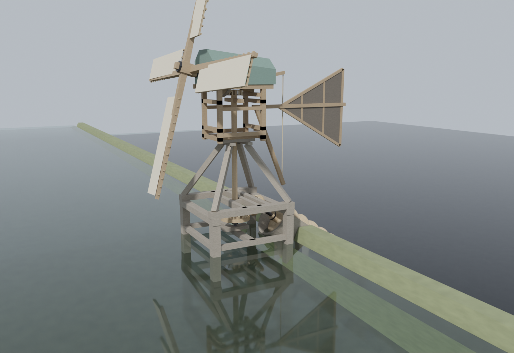
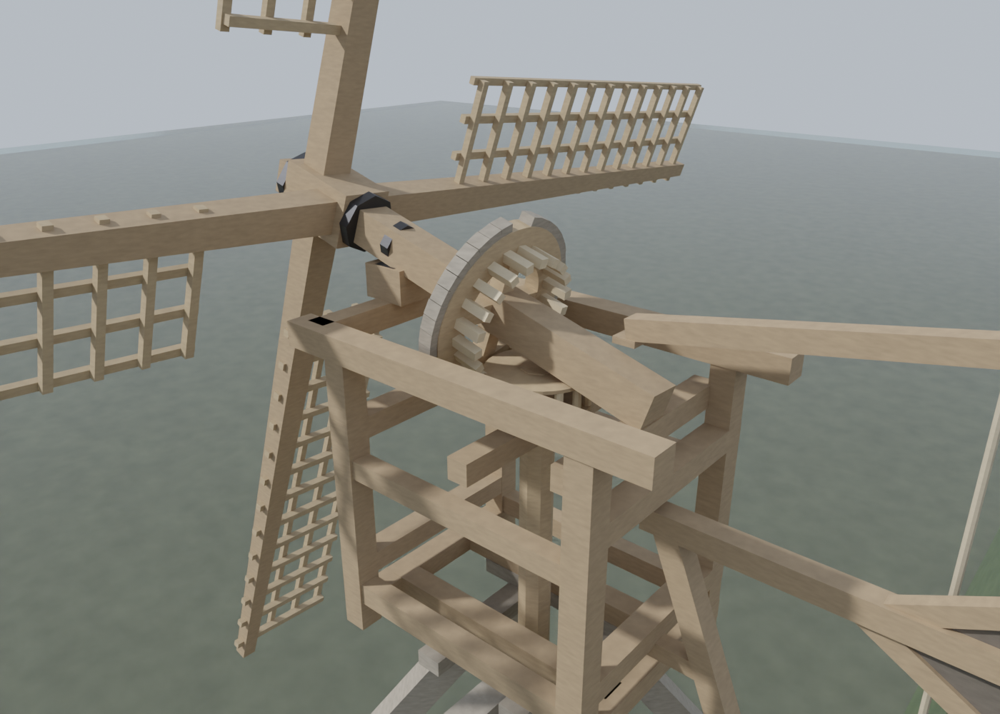
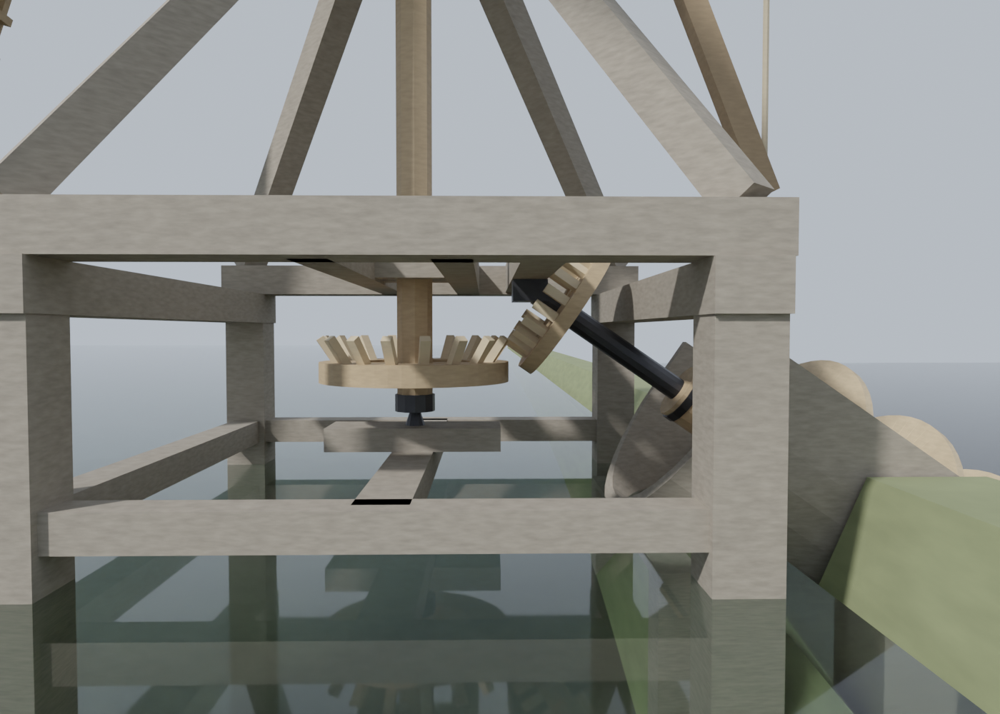

# Vijzel-staartmolentje, Monnickendam 1826

A 3D reconstruction of a small tail-vane windmill driving an Archimedes screw (*vijzel*). It is based on the drawing *Teekening van een Vijzel-Staart-Molentje gebouwd by Monnickendam, 1826*.

**Live viewer:** `index.html` (three.js). It is served through GitHub Pages once Pages is turned on for this repository.



## Viewer

- Two water bodies, as on the drawing: the upper water at Amsterdamsch Peil (+0.81 m) and the lower water at the Waterlyn (0 m), separated by a clay dike.
- The water reflects the sky and the mill, and the ripples respond to the wind.
- A wind-speed slider (0–20 m/s, with Beaufort number) sets the target rotor speed. The sails speed up and slow down smoothly rather than jumping to the new speed.
- Above about 11 m/s the speed levels off, standing in for the miller reefing the sails.
- The gearing turns at the ratios labelled on the drawing: head wheel 20 to lantern 15, and crown wheel 17 to screw wheel 20.
- Buttons for the brake (*vang*), the cap, and the sailcloth.
- Floating debris (bottles, plastic bags, a can, foam, a plank) drifts slowly across the view and bobs with the waves. Flocks of birds, in V-formations or loose groups, cross the frame now and then. Schools of fish occasionally leap from the water at random spots within about 13 m of the mill, with splash rings and droplets.

The rpm values are illustrative, not historical.

## Blender

`blender/build_molentje.py` builds `molentje.blend` procedurally, in metres and to the drawing's scale (6 Rhijnlandsche voeten, 80.5 px per foot on the scan). Drivers animate the drivetrain, and an empty turns the cap and body into the wind.

```
blender --background --python blender/build_molentje.py -- molentje.blend [drawing.jpg]
blender --background --python blender/export_glb.py -- molentje.blend molentje.glb
```

### Notes on the reconstruction

- **Screw position:** the screw is placed on the same axis as its 20-cog wheel so the gearing works. This puts it about 0.3 m higher than drawn.
- **Lower gear sizes:** the lower wheels follow the drawn sizes. Their cog pitches don't match each other on the sheet.
- **Pitch note:** the note on cog pitch ("steek") was not used for sizing.
- **Added detail:** the brake band, the cap boarding, the iron fittings and the clay dike are interpretive additions, not drawn detail.



